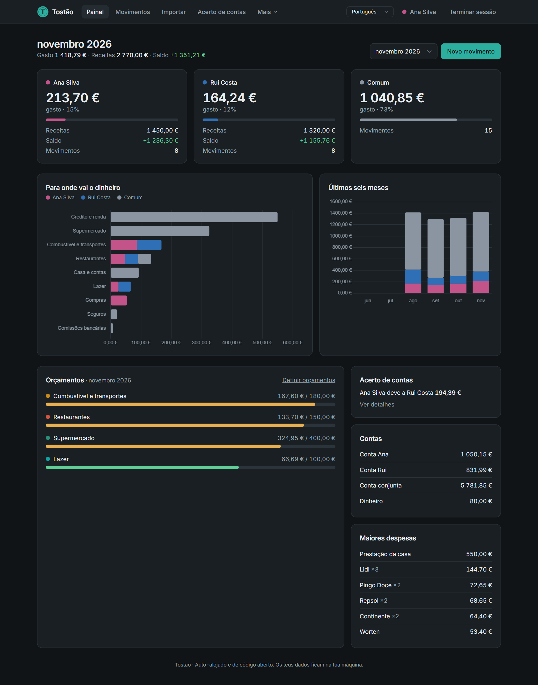
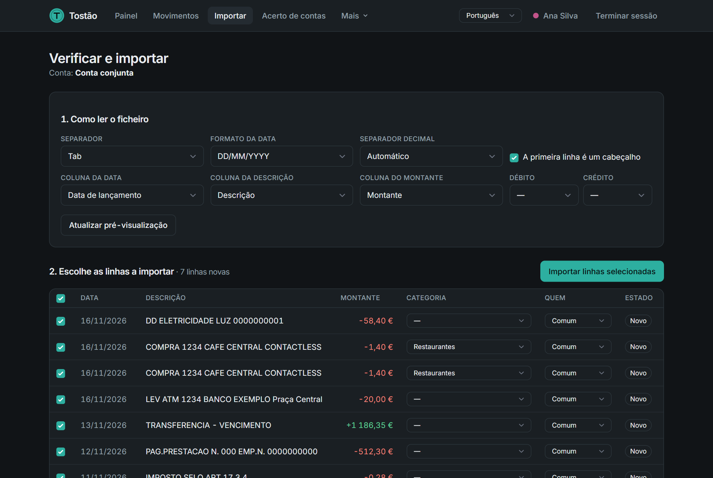
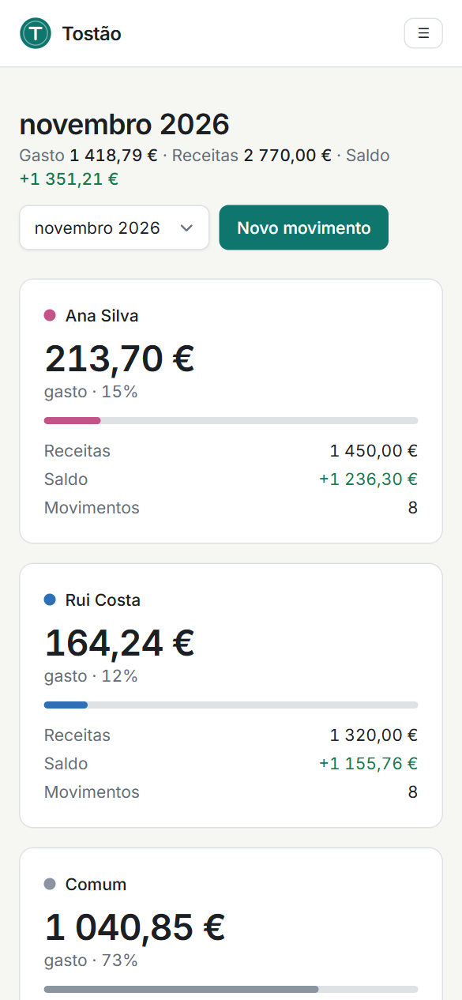

# Tostão

**Finanças da casa para quem partilha o lar.** Importa o extrato do banco, vê quem gasta o quê, planeia o mês, acompanha poupança e investimentos e acerta contas, sem entregar os teus dados a ninguém.

Tostão é uma aplicação **auto-alojada** em Laravel: descarregas, corres no teu computador ou num servidor teu, e os dados ficam numa base de dados tua (SQLite por defeito). Não é um SaaS e não há contas na nuvem. Ligar ao banco ou a uma corretora é **opcional** e desligado por omissão; importar ficheiros funciona sempre, sem terceiros.


<details>
<summary>Modo escuro, importação e telemóvel</summary>

| | |
| --- | --- |
|  |  |
|  |  |



</details>

## Porquê

Dois a viver juntos, uma conta conjunta, duas contas pessoais e um extrato com tudo misturado. As perguntas são sempre as mesmas: quanto gastámos este mês, em quê, quanto é meu e quanto é teu, o que estava planeado, quanto sobra e quem deve a quem. O Tostão responde a isso.

## Funcionalidades

### Pôr os movimentos lá dentro
- **Importação de CSV do banco.** Deteta separador, codificação (incluindo UTF-16), formato da data e colunas; aceita montantes como `-5,50 €`, `1.234,56` ou `(12.30)`, débito e crédito separados, e extratos com dados da conta antes da tabela. Pré-visualização linha a linha antes de guardar. [Guia](docs/IMPORT.md)
- **Importação de extratos em PDF** (Millennium bcp, "Extrato combinado"). O sinal de cada linha sai do saldo corrente, e os movimentos são conferidos com o saldo final impresso no extrato. Um leitor por banco.
- **Importar duas vezes é seguro.** As linhas já importadas ficam assinaladas, e um extrato que se sobrepõe a outro (um a meio do mês e o completo depois) marca como "possível duplicado" o que já existe, em vez de duplicar. Três cafés iguais no mesmo dia continuam a ser três.
- **Ligação direta ao banco (opcional).** Via open banking (PSD2), só em leitura, com fornecedor à escolha: os bancos vêm do fornecedor, e acrescentar um fornecedor é uma classe e uma linha de configuração. Inclui renovação do consentimento. [Guia](docs/BANKS.md)
- **Movimentos recorrentes** (renda, subscrições, ordenado): criam-se sozinhos quando vencem, mesmo que ninguém abra a aplicação durante semanas.

### Perceber para onde vai o dinheiro
- **Painel.** O mês de relance: despesa e receita de cada membro e do que é comum, quanto ficou (e que percentagem do rendimento), o mês contra o plano, a poupança e os investimentos com o que lá puseste e o que ganharam, gráfico por categoria, evolução dos últimos seis meses, orçamentos, maiores despesas e saldo das contas. Em cima aparece só o que precisa de ti: movimentos sem categoria, possíveis transferências entre as tuas contas e ligações ao banco a renovar.
- **Tabela de movimentos que se edita no sítio.** Mudas a categoria e a pessoa na própria linha (guarda logo), ou marcas várias linhas e aplicas de uma vez.
- **Regras de categorização.** "A descrição contém `PINGO DOCE` → Supermercado", com condições opcionais (só se o montante for múltiplo de 5 €, exceto se tiver `LEV ATM`). Um botão em cada movimento cria a regra a partir dele, e "Aplicar aos existentes" corre as regras sobre o que ainda não tem categoria.
- **Orçamentos mensais** por categoria, com barra de progresso e aviso quando passam do limite.
- **Exportação para CSV** (abre bem no Excel) com os filtros aplicados.

### Planear
- **Plano do mês.** O que entra, o que é para sair e o que se põe de lado, por pessoa e por grupo, com despesas fixas (verde), variáveis obrigatórias (amarelo) e opcionais, a parte de cada um nas despesas comuns, linhas que só valem em certos meses (subsídios) e a comparação com o que realmente se gastou. [Guia](docs/PLAN.md)

### Poupança e investimentos
- **Contas de investimento** com o valor por dia e o dinheiro que lá pões e tiras. Depósitos e levantamentos contam como transferências: comprar ações nunca é despesa. [Guia](docs/INVESTMENTS.md)
- **Trading 212 por API** (valor da conta e depósitos). Para corretoras sem API, como a XTB, escreves o valor à mão.
- **Transferências entre as tuas contas.** O Tostão propõe os pares (sai de uma conta, entra noutra, mesmo montante) e tu confirmas; deixam de contar como despesa e receita.

### Em casa
- **Acerto de contas.** Despesas comuns pagas do bolso de um dos dois são divididas em partes iguais (ao cêntimo) e o Tostão diz quem deve a quem. Regista os pagamentos e fica tudo quite.
- **Contas** (à ordem, cartão, dinheiro, poupança, investimentos), cada uma da casa ou de uma pessoa.

### Fiável e privado
- **Cópias de segurança.** `php artisan tostao:backup` guarda uma cópia consistente da base SQLite, e corre todas as noites com o agendador. [Guia](docs/DEPLOY.md)
- **Português e inglês**, modo claro e escuro automáticos, responsivo.
- **Privado por desenho.** Sem rastreio, sem pedidos a terceiros (o tipo de letra vai incluído), sem registo público: só se entra com a conta de um membro. As ligações opcionais ao banco e à corretora usam chaves que ficam no teu `.env`.

## Instalação

Requisitos: PHP 8.4+, Composer, Node 20+ (só para compilar os ficheiros de interface).

```sh
git clone https://github.com/carlospinhowedev/tostao.git
cd tostao
composer setup      # dependências, .env, chave, base de dados SQLite, build
php artisan serve
```

Abre `http://localhost:8000`. No primeiro acesso crias a casa (o primeiro membro) e ficas com categorias e uma conta de arranque. Depois adicionas a outra pessoa em **Mais → Membros**.

**Quero ver com dados antes de usar:**

```sh
composer demo       # apaga a base de dados e carrega um casal inventado, com plano e investimentos
```

Entra com `ana@example.com` / `password`. Tudo o que lá está é inventado.

### Tarefas agendadas

Recorrentes, cópias de segurança e sincronizações (se as ligares) correm sozinhos se o agendador do Laravel estiver ativo:

```sh
* * * * * cd /caminho/para/tostao && php artisan schedule:run >> /dev/null 2>&1
```

Sem ele, os recorrentes são criados quando alguém abre o painel, e podes correr `php artisan tostao:backup` à mão.

### Laravel Herd e DBngin (Windows e macOS)

```sh
herd link tostao            # fica em http://tostao.test
```

Para usar MySQL em vez de SQLite, cria uma base de dados no DBngin e põe no `.env`:

```dotenv
DB_CONNECTION=mysql
DB_HOST=127.0.0.1
DB_PORT=3306
DB_DATABASE=tostao
DB_USERNAME=root
DB_PASSWORD=
```

depois `php artisan migrate`. Mais opções (servidor próprio, cópias de segurança, agendador) em [docs/DEPLOY.md](docs/DEPLOY.md).

### Ligações opcionais

Nada disto é preciso para usar o Tostão. Cada ligação precisa de chaves tuas no `.env`:

| Para | Variáveis | Guia |
| --- | --- | --- |
| Ligar ao banco (open banking) | `ENABLE_BANKING_APP_ID`, `ENABLE_BANKING_KEY_PATH` | [docs/BANKS.md](docs/BANKS.md) |
| Trading 212 | `TRADING212_API_KEY`, `TRADING212_API_SECRET` | [docs/INVESTMENTS.md](docs/INVESTMENTS.md) |

## Testes

```sh
composer test
```

194 testes em Pest. A suite passa em SQLite (e a base foi também testada em MySQL 9). Cobre a leitura de valores e datas, a importação de ponta a ponta (CSV e PDF, duplicados e sobreposições), o painel, o plano, o acerto de contas, as transferências, os recorrentes, o isolamento do registo e os fornecedores de banco e corretora com respostas simuladas. Um teste garante que todas as frases da interface têm tradução.

## Stack

Laravel 13 · Blade + Alpine.js · Tailwind CSS 3 · Chart.js · Pest · SQLite/MySQL · autenticação Laravel Breeze · `smalot/pdfparser` para os extratos em PDF. Decisões e estrutura em [docs/ARCHITECTURE.md](docs/ARCHITECTURE.md).

## Documentação

| | |
| --- | --- |
| [docs/IMPORT.md](docs/IMPORT.md) | Importar extratos (CSV e PDF), períodos que se sobrepõem, e o que fazer quando não funciona à primeira |
| [docs/PLAN.md](docs/PLAN.md) | O plano do mês: tipos de despesa, grupos, subsídios, plano contra real |
| [docs/INVESTMENTS.md](docs/INVESTMENTS.md) | Poupança e investimentos, Trading 212, XTB, transferências entre contas |
| [docs/BANKS.md](docs/BANKS.md) | Ligar ao banco por open banking (opcional) |
| [docs/ARCHITECTURE.md](docs/ARCHITECTURE.md) | Modelo de dados, decisões e porquê |
| [docs/DEPLOY.md](docs/DEPLOY.md) | Herd, DBngin, servidor próprio, cópias de segurança |
| [docs/CASE-STUDY.md](docs/CASE-STUDY.md) | A história do projeto: do extrato colado ao produto |
| [CONTRIBUTING.md](CONTRIBUTING.md) | Como contribuir |

## Estado e limites

Honestidade sobre o que está testado e o que não está:

- **A ligação ao banco (Enable Banking) e ao Trading 212 foram escritas a partir da documentação pública e testadas com respostas simuladas**, não contra os serviços reais. Os guias dizem como diagnosticar.
- **Os extratos em PDF só estão suportados para o "Extrato combinado" do Millennium bcp.** Os outros bancos usam CSV. Acrescentar um banco é uma classe.
- A XTB desativou a API em 2025: o valor da conta escreve-se à mão.
- A divisão das despesas comuns é sempre em partes iguais. Dividir em proporção ao rendimento está na lista.
- Uma instalação é uma casa. Várias casas no mesmo servidor não é um objetivo.
- Sem Docker, sem autenticação em dois passos e sem aplicação móvel nativa (o site funciona bem no telemóvel).
- Não divide um movimento por várias categorias.

## English, in short

Tostão is a self-hosted household finance app for people who share a home (couples, flatmates). It imports bank CSV and PDF statements (an overlapping import never doubles rows up), shows who spends what per person and category, plans the month (fixed, variable and optional costs, per person and group, against what really happened), tracks savings and brokerage accounts (deposits are transfers, never spending), pairs up transfers between your own accounts, splits shared expenses and tells you who owes whom. Rules categorise as you import, and the transactions table edits in place. Optional open-banking and Trading 212 connections use keys that stay in your `.env`. One install is one household; data stays in your own SQLite or MySQL database. Install with `composer setup && php artisan serve`, try the invented demo with `composer demo` (`ana@example.com` / `password`). Portuguese and English interface. MIT licensed.

## Licença

[MIT](LICENSE) © Carlos Pinho
