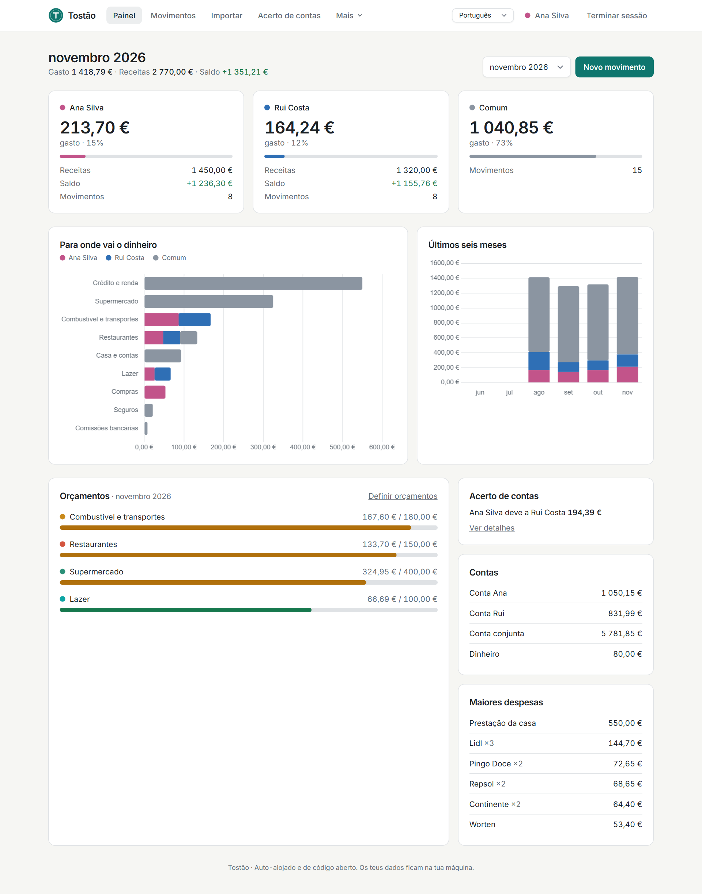
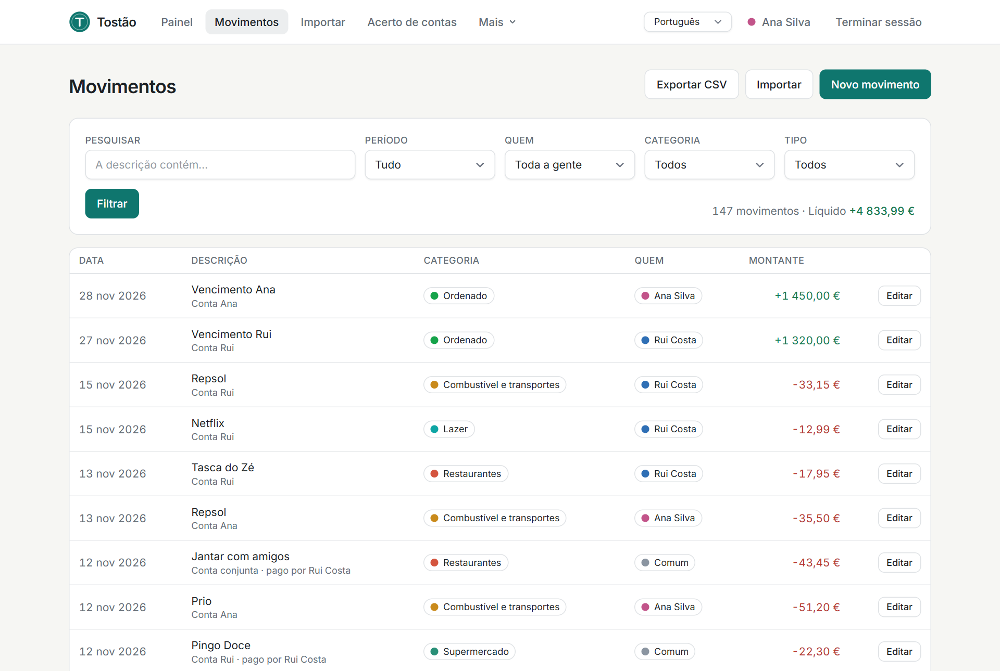
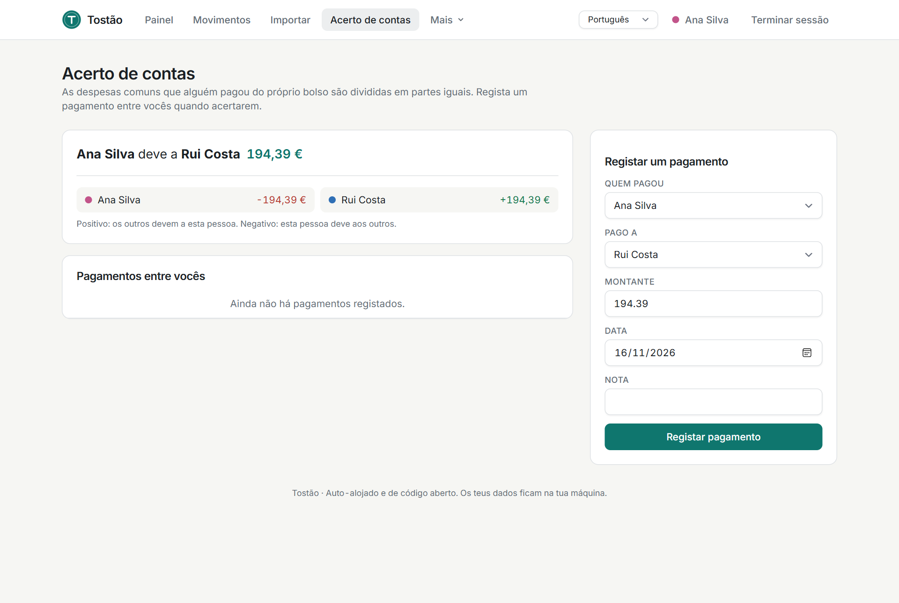

# Tostão

**Finanças da casa para quem partilha o lar.** Importa o extrato do banco, vê quem gasta o quê, acompanha orçamentos e acerta contas, sem entregar os teus dados a ninguém.

Tostão é uma aplicação **auto-alojada** em Laravel: descarregas, corres no teu computador ou num servidor teu, e os dados ficam numa base de dados tua (SQLite por defeito). Não é um SaaS, não há contas na nuvem, não há ligação ao banco.



<details>
<summary>Modo escuro, importação e telemóvel</summary>

| | |
| --- | --- |
|  |  |
|  |  |


</details>

## Porquê

Dois a viver juntos, uma conta conjunta, duas contas pessoais e um extrato em CSV com tudo misturado. As perguntas são sempre as mesmas: quanto gastámos este mês, em quê, quanto é meu e quanto é teu, e quem deve a quem. O Tostão responde a isso e a mais nada.

## Funcionalidades

- **Painel por pessoa e por categoria.** Despesa e receita de cada membro e do que é comum, gráfico por categoria, evolução dos últimos seis meses, maiores despesas e saldo das contas.
- **Importação de CSV do banco.** Deteta separador, codificação, formato da data e colunas; aceita montantes como `-5,50 €`, `1.234,56` ou `(12.30)`; coluna única de montante ou débito e crédito separados. Pré-visualização linha a linha antes de guardar. [Guia](docs/IMPORT.md)
- **Importar duas vezes é seguro.** Cada linha tem uma assinatura estável; as já importadas ficam assinaladas. Linhas idênticas no mesmo dia (três cafés) são todas mantidas.
- **Regras de categorização.** "A descrição contém `PINGO DOCE` → Supermercado". Preenchem a categoria e a pessoa na importação.
- **Orçamentos mensais** por categoria, com barra de progresso e aviso quando passam do limite.
- **Acerto de contas.** Despesas comuns pagas do bolso de um dos dois são divididas em partes iguais (ao cêntimo) e o Tostão diz quem deve a quem. Regista os pagamentos e fica tudo quite.
- **Movimentos recorrentes** (renda, subscrições, ordenado). Criam-se sozinhos quando vencem, mesmo que ninguém abra a aplicação durante semanas.
- **Transferências entre as vossas contas não contam** como despesa nem receita.
- **Contas** (à ordem, cartão, dinheiro, poupança), cada uma da casa ou de uma pessoa.
- **Exportação para CSV** (abre bem no Excel) com os filtros aplicados.
- **Português e inglês**, modo claro e escuro automáticos, responsivo.
- **Privado por desenho.** Sem rastreio, sem pedidos a terceiros (o tipo de letra vai incluído), sem registo público: só se entra com a conta de um membro.

## Instalação

Requisitos: PHP 8.4+, Composer, Node 20+ (só para compilar os ficheiros de interface).

```sh
git clone https://github.com/<utilizador>/tostao.git
cd tostao
composer setup      # dependências, .env, chave, base de dados SQLite, build
php artisan serve
```

Abre `http://localhost:8000`. No primeiro acesso crias a casa (o primeiro membro) e ficas com categorias e uma conta de arranque. Depois adicionas a outra pessoa em **Mais → Membros**.

**Quero ver com dados antes de usar:**

```sh
composer demo       # apaga a base de dados e carrega um casal inventado
```

Entra com `ana@example.com` / `password`. Tudo o que lá está é inventado.

### Laravel Herd e DBngin (Windows e macOS)

```sh
herd link tostao            # fica em http://tostao.test
```

Para usar MySQL em vez de SQLite, cria uma base de dados no DBngin e põe no `.env`:

```dotenv
DB_CONNECTION=mysql
DB_HOST=127.0.0.1
DB_PORT=3306
DB_DATABASE=tostao
DB_USERNAME=root
DB_PASSWORD=
```

depois `php artisan migrate`. Mais opções (servidor próprio, cópias de segurança, agendador) em [docs/DEPLOY.md](docs/DEPLOY.md).

## Testes

```sh
composer test
```

116 testes em Pest. A suite passa em SQLite e em MySQL 9. Cobre a leitura de valores e datas, a importação de ponta a ponta (incluindo duplicados), o dashboard, o acerto de contas, os recorrentes e o isolamento do registo. Um teste garante que todas as frases da interface têm tradução.

## Stack

Laravel 13 · Blade + Alpine.js · Tailwind CSS 3 · Chart.js · Pest · SQLite/MySQL · autenticação Laravel Breeze. Decisões e estrutura em [docs/ARCHITECTURE.md](docs/ARCHITECTURE.md).

## Documentação

| | |
| --- | --- |
| [docs/IMPORT.md](docs/IMPORT.md) | Como importar o extrato do teu banco, e o que fazer quando não funciona à primeira |
| [docs/ARCHITECTURE.md](docs/ARCHITECTURE.md) | Modelo de dados, decisões e porquê |
| [docs/DEPLOY.md](docs/DEPLOY.md) | Herd, DBngin, servidor próprio, cópias de segurança |
| [docs/CASE-STUDY.md](docs/CASE-STUDY.md) | A história do projeto: do extrato colado ao produto |
| [CONTRIBUTING.md](CONTRIBUTING.md) | Como contribuir |

## O que ainda não faz

Por escolha ou por falta de tempo, e à espera de quem precisar:

- Não liga ao banco (sem PSD2): importas o ficheiro que o banco te dá.
- A divisão é sempre em partes iguais. Dividir em proporção ao rendimento está na lista.
- Uma instalação é uma casa. Várias casas no mesmo servidor não é um objetivo.
- Sem aplicação móvel nativa; o site funciona bem no telemóvel.

## English, in short

Tostão is a self-hosted household finance app for people who share a home (couples, flatmates). It imports bank CSV exports, shows who spends what per person and category, tracks budgets, splits shared expenses and tells you who owes whom. One install is one household; data stays in your own SQLite or MySQL database. Install with `composer setup && php artisan serve`, try the invented demo with `composer demo` (`ana@example.com` / `password`). The interface is available in Portuguese and English. MIT licensed.

## Licença

[MIT](LICENSE) © Carlos Pinho
