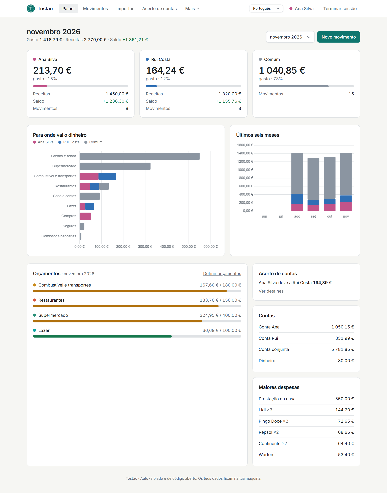

# Case study: Tostão

> Uma aplicação Laravel auto-alojada para as finanças de quem partilha uma casa. Do problema real, um extrato do banco colado numa conversa, a um produto documentado, testado e pronto a descarregar.

| | |
| --- | --- |
| **Tipo** | Projeto pessoal, open source (MIT) |
| **Papel** | Ideia, requisitos e direção do produto; implementação com o agente de IA Claude Code |
| **Stack** | PHP 8.4 · Laravel 13 · Blade · Alpine.js · Tailwind CSS · Chart.js · Pest · SQLite/MySQL |
| **Resultado** | Importação de extratos, painel por pessoa, orçamentos, acerto de contas, recorrentes, PT/EN, 100+ testes |

## 1. O problema

Partilho as contas de casa com outra pessoa. O extrato do banco é um ficheiro com tudo misturado: a renda, o supermercado, o café de cada um, as transferências entre contas. Para responder a *quanto gastámos este mês, em quê, quanto é de cada um e quem deve a quem*, cada linha do extrato tinha de ser marcada à mão com a pessoa a que pertencia (eu, a outra pessoa, ou "Juntos"), e algumas compras vinham só como anotações à parte, associadas a uma transferência.

Isso falha de formas previsíveis: dá trabalho, não escala de um mês para o seguinte, e as transferências entre as nossas contas inflacionam as despesas de todos os meses.

## 2. O que eu queria (e o que recusei)

Os requisitos foram poucos e firmes:

- **Para uso pessoal, não um SaaS.** Qualquer pessoa descarrega, corre e fica com os dados na sua máquina. Isto tira do caminho planos, inquilinos e faturação, e põe a privacidade como ponto de partida e não como funcionalidade.
- **Seguir os padrões da indústria**, porque o repositório também é um portfólio: Laravel idiomático, testes, estilo de código automático, integração contínua, documentação que se lê.
- **Bem documentado.** Quem chega ao repositório deve conseguir instalar, experimentar com dados de demonstração e perceber as decisões sem me perguntar nada.
- **Um produto fixe**, e não um protótipo: modo escuro, telemóvel, português e inglês, estados vazios com sentido.

Recusei de propósito, na primeira versão: ligação direta ao banco (PSD2), várias casas por instalação, aplicação móvel e contas de investimento. Cada uma delas multiplicaria o âmbito sem resolver as perguntas iniciais. Depois de a usar com extratos reais, parte do que recusei voltou como **camadas opcionais e desligadas por omissão** (ligação ao banco, investimentos), porque o núcleo já estava sólido e a privacidade não ficava em causa. Várias casas e aplicação móvel continuam fora.

## 3. Como chegámos aqui

1. **Dados antes de código.** Comecei por colar um extrato real e pedir o resumo por pessoa (quem gastou quanto, o que é comum). Isso mostrou logo o primeiro problema: as transferências entre contas distorcem tudo.
2. **Um painel de protótipo.** A seguir pedi um painel simples sobre esses dados, para ver se as perguntas estavam certas antes de investir numa aplicação. Estavam, e a pergunta seguinte ("como é que isto entra sem eu escrever tudo?") passou a ser a funcionalidade principal: a importação.
3. **A aplicação.** Pedi uma aplicação Laravel para uso pessoal, que qualquer pessoa pudesse descarregar, seguindo os padrões da indústria, bem documentada e com mais funcionalidades do que o protótipo, e deixei ao agente a decisão de quais e como. O importador ficou como núcleo e o resto (painel, orçamentos, acerto de contas) foi construído à volta dele.

## 4. Decisões que valem a pena contar

**Dinheiro em cêntimos inteiros.** Somar decimais em vírgula flutuante acumula erros de cêntimo e o painel deixa de bater com o banco. Tudo é `bigint` em cêntimos, e uma pequena classe converte o que as pessoas escrevem e o que os bancos exportam (`-5,50 €`, `1.234,56`, `(12.30)`). A divisão de uma despesa por duas pessoas distribui os cêntimos que sobram: a soma das partes é sempre o total.

**Uma instalação, uma casa.** Sem tabela de "casas" nem coluna de inquilino. Os membros são utilizadores e o registo só está aberto até existir o primeiro. É menos flexível e muito menos código, e é exatamente o que o produto promete.

**"Comum" é `owner_id = null`.** Um movimento é de um membro ou da casa. Para despesas comuns pagas do bolso de alguém existe `paid_by_id`, que alimenta o acerto de contas. Pagas pela conta conjunta, não geram dívida.

**Transferências não são despesa.** As categorias têm um tipo (`expense`, `income`, `transfer`) e todas as somas passam por um único serviço que ignora as transferências.

**Importar duas vezes tem de ser seguro.** Cada linha ganha uma assinatura (conta, data, montante, descrição e número de ocorrência) numa coluna única. O número de ocorrência resolve um caso subtil: três cafés de 1,40 € no mesmo dia são três movimentos legítimos, não duplicados. É a base de dados, e não a interface, que garante a regra.

**Importação sem estado.** O ficheiro fica guardado sob um UUID e é relido em cada passo com as definições do formulário. Sem tabela de importações, sem sessão para gerir.

**Recorrentes sem obrigar a configurar um cron.** Quem aloja em casa raramente tem agendador. O painel gera o que estiver vencido quando é aberto; o comando agendado faz o mesmo para quem preferir. Cada item avança a sua própria data, por isso apanhar três meses em atraso cria exatamente três movimentos.

**Sem pedidos a terceiros.** Tipo de letra e bibliotecas vão no build. Para uma aplicação de privacidade, não faz sentido carregar uma CDN.

Mais detalhe e o modelo de dados em [ARCHITECTURE.md](ARCHITECTURE.md).

## 5. Qualidade

- **Testes em Pest** de duas camadas: lógica difícil em testes unitários rápidos (valores, datas, leitura de CSV, divisão de cêntimos) e fluxos completos em testes de funcionalidade (importar, reimportar, painel, acertos, recorrentes em atraso, registo).
- **Fixture realista com dados inventados** que reproduz a forma de um extrato português: separado por tabuladores, `-5,50 €`, milhares com ponto, linhas em branco, ordenado sem símbolo de euro.
- **SQLite e MySQL:** a suite corre nos dois. Não há SQL específico de um motor.
- **Os testes apanharam um erro real.** Em SQLite o Eloquent guarda as datas como `2026-11-30 00:00:00`; um `BETWEEN '2026-11-01' AND '2026-11-30'` deixava de fora o último dia de cada mês, tanto nos filtros como na deteção de duplicados. Foi encontrado por um teste de intervalo de datas e corrigido num único ponto (`Transaction::betweenDates()`).
- **Um teste que protege as traduções:** falha se alguma frase da interface não tiver tradução.
- **Os leitores de PDF e de APIs externas também são testados:** o do PDF com texto inventado no mesmo formato (incluindo quebras de página e saldo negativo) e com a verificação do saldo final; os dos fornecedores com respostas HTTP simuladas.
- **Estilo automático** (Laravel Pint) e um fluxo de integração contínua no GitHub Actions.

## 6. Resultado

Uma aplicação que se instala com `composer setup`, abre com um casal de demonstração inventado (`composer demo`) e responde às perguntas originais: quanto gastámos, em quê, quem gasta o quê, quanto falta no orçamento de cada categoria e quem deve a quem.

Números do repositório: cerca de 6.000 linhas de PHP (aplicação, rotas, configuração e migrações), cerca de 1.800 de testes (194 testes), 48 ficheiros Blade e 7 documentos de apoio.

O que a aplicação ganhou depois de ser usada com extratos reais, por ordem de aparecimento:

- **Leitura de extratos em PDF** (Millennium bcp): o sinal de cada linha sai do saldo corrente, e os movimentos são conferidos com o saldo final impresso, para um erro de leitura nunca passar em silêncio.
- **Importação robusta:** ficheiros UTF-16, extratos com dados da conta antes da tabela, e períodos que se sobrepõem (as linhas que já existem ficam como "possível duplicado" em vez de se repetirem).
- **Plano do mês** com despesas fixas, variáveis e opcionais, por pessoa e por grupo, comparado com o que se gastou de facto.
- **Edição no sítio** na tabela de movimentos, edição em massa e regras com condições (montante, exclusões).
- **Transferências entre as próprias contas** propostas e confirmadas, para não contarem como despesa.
- **Investimentos:** contas com o valor por dia, depósitos como transferências, e um fornecedor para o Trading 212.
- **Ligação opcional ao banco** por open banking, atrás de uma interface (um fornecedor é uma classe e uma linha de configuração), e cópias de segurança agendadas.

## 7. Limites e o que faria a seguir

Sou direto sobre o que não está feito:

- Foi testado com **um banco** (extratos CSV e PDF do Millennium bcp) e com o que a fixture reproduz. Outros bancos vão exigir ajustes; por isso o importador mostra sempre uma pré-visualização, o PDF só é aceite nos formatos conhecidos, e o guia explica como diagnosticar. É o ponto mais provável de os utilizadores precisarem de ajuda.
- A **ligação ao banco (Enable Banking) e ao Trading 212 foi escrita a partir da documentação pública e testada com respostas simuladas**, não contra os serviços reais. A XTB desativou a API em 2025, por isso o valor dessa conta escreve-se à mão.
- A divisão é **sempre em partes iguais**. Proporcional ao rendimento é o próximo passo natural.
- Não incluí Docker porque não o consegui testar no meu ambiente; prefiro não publicar o que não verifiquei.
- Sem autenticação em dois passos, e um movimento não se divide por várias categorias.

## 8. Como foi construído

O projeto foi desenvolvido numa sessão de trabalho com um agente de IA (Claude Code). Eu defini o problema, as restrições e o que significava "produto fixe", e delegei as decisões de funcionalidades e de arquitetura; o agente escreveu o código, os testes e a documentação. O resultado foi verificado com a suite de testes (em SQLite e MySQL), com a aplicação a correr no browser e com uma revisão independente do código antes de fechar, que apanhou, entre outras coisas, valores reais que tinham ficado nos dados de exemplo.

## 9. Para usar em formação

O repositório é pequeno o suficiente para ser lido por inteiro e real o suficiente para ter problemas verdadeiros. Serve de material para um módulo de Laravel intermédio.

**Conceitos que ilustra, com onde ver cada um**

| Conceito | Onde |
| --- | --- |
| Migrações e relações Eloquent | `database/migrations`, `app/Models` |
| Validação e regras personalizadas | `app/Rules/Amount.php`, controladores |
| Classes de serviço e controladores finos | `app/Services`, `app/Http/Controllers` |
| Tratamento de ficheiros enviados com segurança | `ImportController` (UUID, validação, limpeza) |
| Componentes Blade e layouts | `resources/views/components`, `layouts` |
| Alpine.js para o pouco que precisa de JS | formulário de movimentos, menu |
| Internacionalização | `lang/pt.json`, `TranslationsTest` |
| Agendador e comandos Artisan | `routes/console.php` |
| Testes com Pest (unitários e de funcionalidade) | `tests/` |
| Dados de demonstração determinísticos | `database/seeders/DemoSeeder.php` |

**Exercícios propostos** (do mais simples ao mais exigente)

1. Acrescentar uma categoria nova e uma regra, e ver o efeito numa importação.
2. Escrever o teste de um formato de data novo em `DateParser`.
3. Fazer o painel mostrar a poupança do mês (receitas menos despesas) como percentagem.
4. Adicionar orçamento por pessoa e por categoria.
5. Dividir as despesas comuns em proporção ao rendimento de cada membro (altera `SettleUp` e a base de dados).
6. Suportar outro banco: escrever uma fixture inventada, o teste que falha, e a correção.
7. Acrescentar um idioma.

**Discussões que o código abre:** dinheiro em cêntimos versus decimais; quando a agregação em PHP deixa de ser boa ideia; o custo de não ter multi-inquilino; porque é que a unicidade de uma importação se garante na base de dados e não na interface.

## 10. Para o currículo

Linhas curtas, prontas a adaptar:

- **Tostão** (projeto open source): aplicação Laravel auto-alojada de finanças para casais e casas partilhadas, com importação de extratos CSV e PDF (verificada com o saldo final), deteção de duplicados e de sobreposições, plano mensal, painel por pessoa, investimentos e acerto de contas, e ligação opcional a bancos e corretoras. 194 testes em Pest, SQLite e MySQL, interface PT/EN com modo escuro.
- Decisões de engenharia documentadas: dinheiro em cêntimos, importação idempotente, agregação independente do motor de base de dados.
- Desenvolvido com um agente de IA: especificação, arquitetura, código e testes, com validação contínua.

**Tecnologias:** PHP 8.4 · Laravel 13 · Eloquent · Blade · Alpine.js · Tailwind CSS · Chart.js · Pest · SQLite · MySQL · GitHub Actions · Laravel Herd
